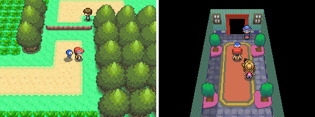
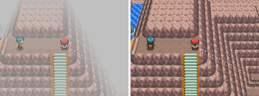
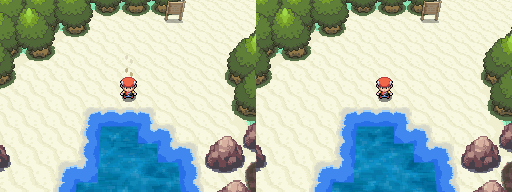
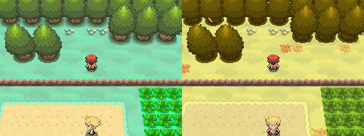
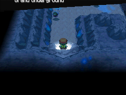
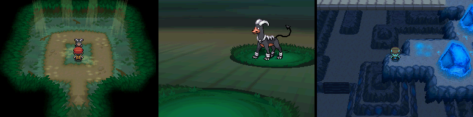
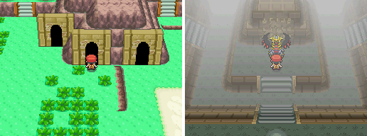
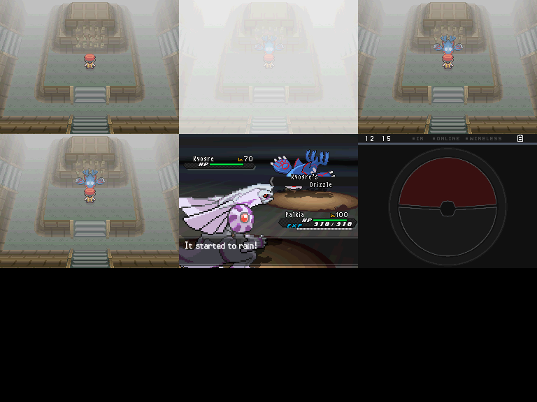
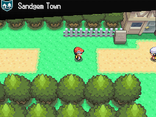

# Pokémon Adamant Diamond & Lustrous Pearl

Sinnoh's Diamond and Pearl rebuilt inside Pokémon Black 2, in the Gen 5 style. Lustrous Pearl is out as an alpha;
Adamant Diamond comes next. Releases are `.bps` patches only; no ROMs are ever included.

## Playing it
1. Get a clean **Pokémon Black 2 (USA)** ROM from your own cartridge.
2. Apply the release's `.bps` patch with any BPS patcher (Floating IPS, Rom Patcher JS).
3. Play it in melonDS or on hardware. DeSmuME hides some bugs that melonDS and hardware show.

## Status: alpha 0.1
- **Story:** Pearl's whole story, from Twinleaf to the Hall of Fame. Post-game: the National Pokédex at Champion,
  the Battle Zone, Stark Mountain, Snowpoint Temple, Turnback Cave, Fullmoon and Newmoon Islands, and the event
  Pokémon (Darkrai, Shaymin, Arceus, the Manaphy Egg) from the Pokémon Center deliveryman.
- **Features:** the Grand Underground with wandering Pokémon; Pal Park with BDSP's Ramanas Park rooms; roaming
  Mesprit and Cresselia; following Pokémon (Rowan's fourth question); Pearl's TMs, HMs, Rock Climb and Defog.
- **Experimental (untested):** the Pokétch apps beyond the Digital Watch, and Pal Park's migration from a GBA game in
  slot 2. Chapter 9b (Fullmoon, Newmoon, Routes 219-221, Trophy Garden, Rotom, Spiritomb) is in but hasn't been
  played through yet.
- **Not in yet:** the Battle Tower and the PWT, Super Contests, digging and Secret Bases in the Underground.

## Screenshots
| | |
|---|---|
|  | Following Pokémon: your first Pokémon walks behind you, and you can talk to it |
|  | Weather: Route 210's fog, then cleared with Defog |
|  | Black 2's animated sea on Pearl's Route 219 |
|  | Route 201 in summer and autumn |
|  | The Grand Underground: Pokémon wandering in a Hideaway |
|  | Hidden Grottos and the Hideaways |
|  | Pal Park's Ramanas rooms; Giratina in Turnback Cave |
|  | Placing the Oceanic Slate: Kyogre appears |
|  | Sinnoh's place names on arrival |

## For developers
- Start with `notes/START_HERE.md` (open decisions and status), then `notes/PLAN.md` (feasibility and phases).
- `notes/DECISIONS.md`: every decision, dated, with who made it.
- The game's C changes live in a branch of the pokebw2 decomp (`pearlb2`), not published yet.

This project is built with the help of AI coding tools (Anthropic's Claude).

## Credits
- Pokémon Pearl and Pokémon Black 2: Game Freak, Nintendo, The Pokémon Company. This is a fan project.
- The player's battle back as Lucas: "Trainer Lucas back BW style" by tebited15 (DeviantArt, free use;
  `art_sources/fan_tebited15_lucas_back/CREDIT.txt`).
- The Pokémon Black 2 decompilation (pokebw2) and the Diamond/Pearl and Platinum decompilations (pokediamond,
  pokeplatinum), which this work reads.
